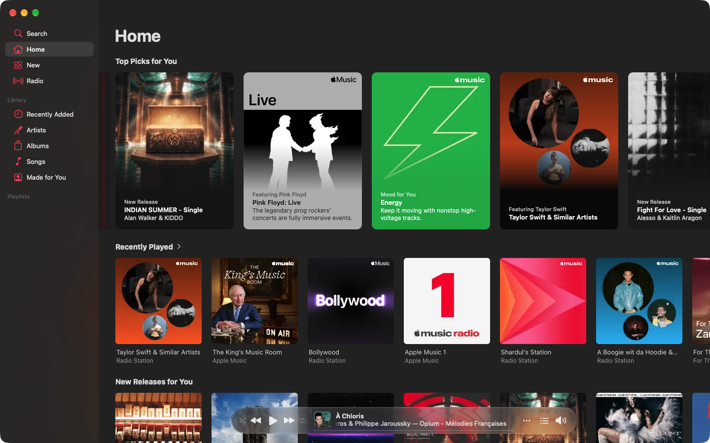
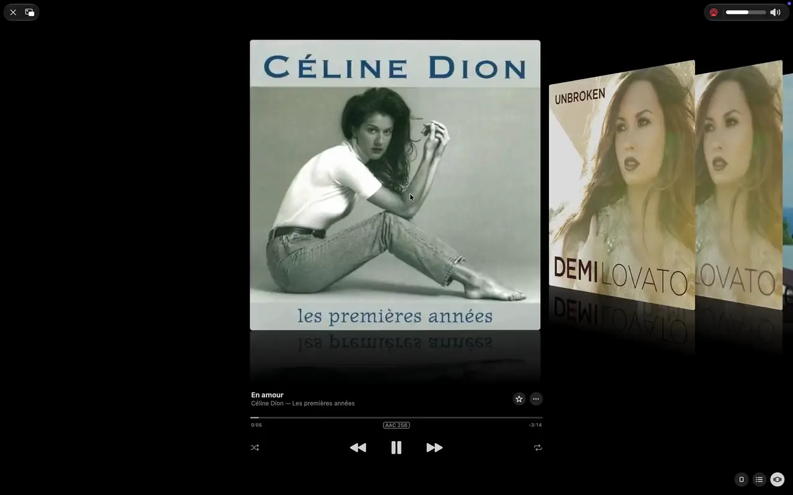
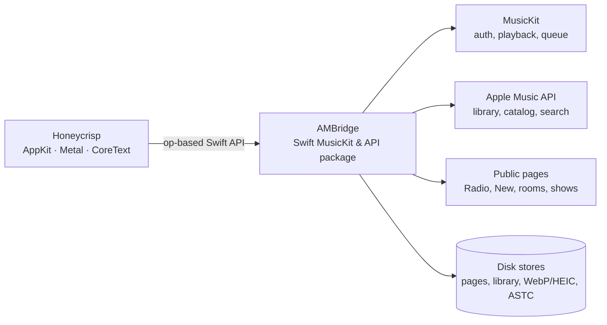
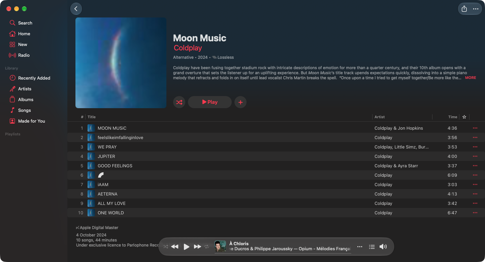
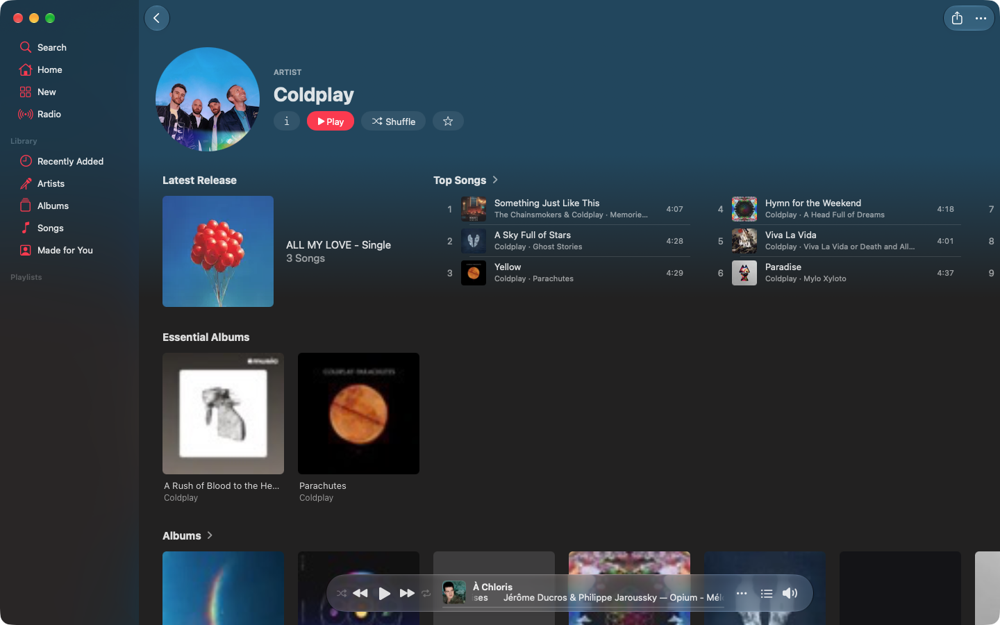
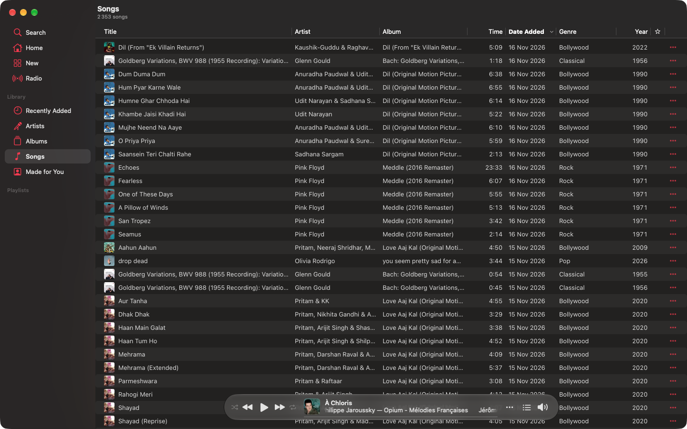
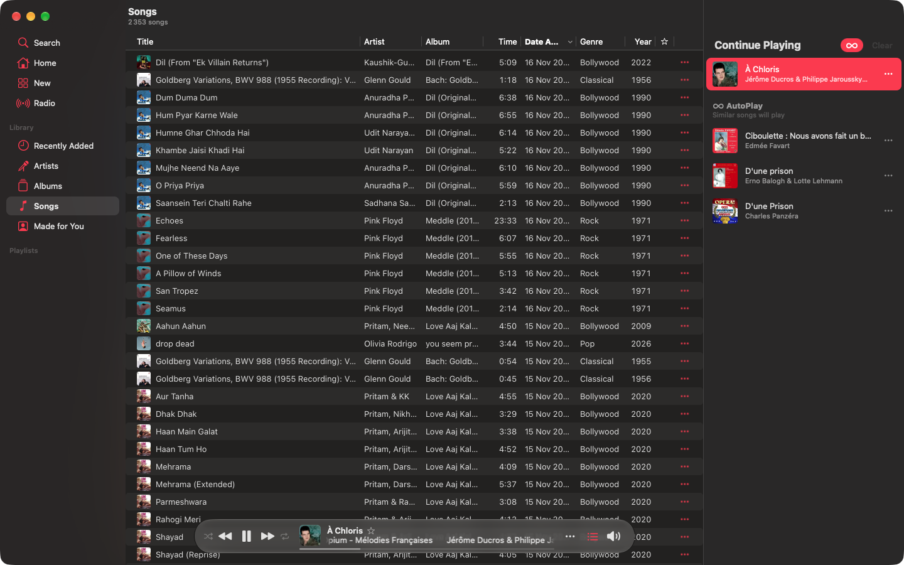
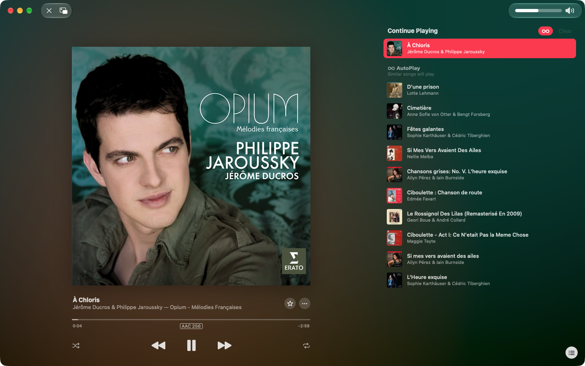
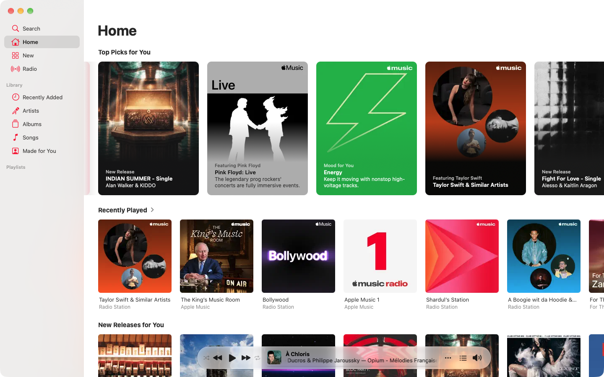

# Honeycrisp

**A fast, lightweight native Apple Music client for macOS.**

Built to feel instant and stay light on memory—even on an 8 GB MacBook. Pure AppKit, Metal, and
Swift on Apple's official MusicKit and Apple Music API, with no Electron, no web views, and only
one external dependency ([Sparkle 2](https://sparkle-project.org) for automatic updates).

## Download

**[Download latest release (DMG)](https://github.com/sharduldhande/Honeycrisp/releases/latest)** —
open the ~18.5 MB notarized DMG and drag Honeycrisp to Applications. *(Early preview: works day to
day, rough edges expected.)*

**Requirements:** Apple silicon Mac (M1 or later) · macOS 27 · Apple Music subscription
*(without one you can browse, but tracks won't play; click **Allow** when macOS asks for Apple
Music access).*

---

## Instant live search

Results update on every keystroke with no Return: your library answers immediately from memory
(with typo tolerance and romanized spelling matching), while Apple Music catalog results stream in
underneath.

---

## Cover Flow is back (in Metal)

Open the full player to flip through your active or shuffled queue as a 3D wall of album covers
with live reflections. Flick, drag, use arrow keys, click any cover to play, or pinch to change
density.

To keep fast flicking smooth without spiking memory on an 8 GB Mac, Cover Flow runs on a
**two-tier GPU-compressed ASTC texture pipeline in Metal**: small disk-cached ASTC covers upload
straight to GPU memory for the side stacks, while full-resolution covers around the center (and the
predicted flick landing) encode asynchronously on a separate queue so reads never stall. Closing or
hiding Cover Flow tears down the Metal view and drawables immediately, dropping memory right back
below baseline.

---

## Benchmarks at a glance

Measured on the same Mac mini M1 (8 GB, macOS 27.2, 120 Hz) with the same Apple Music account and
2,353-song library, apps alternating.

| Metric | Honeycrisp | Apple's Music app | Difference |
|---|---:|---:|---|
| Launch to window | **485 ms** | 1,316 ms | **2.7× faster** |
| Open a playlist | **98 ms** | 413 ms | **4.2× faster** |
| Open an album from Home | **167 ms** | 395 ms | **2.4× faster** |
| Album grid scroll: frames missed | **10 %** | 38 % | **3.7× fewer** |
| Peak RAM (app process, ~5-min session) | **300 MB** | 723 MB | **2.4× less** |
| Energy (30-min session, CPU est.) | **55 J** | 147 J | **2.7× less** |
| App size on disk | **22 MB** | 65 MB | **2.9× smaller** |

Full tables and 8 GB memory-pressure tests are in
[Full numbers](#full-numbers) and [docs/NUMBERS.md](docs/NUMBERS.md).

---

## How it stays fast on 8 GB RAM

- **Disk-first pages, background refresh:** Home, New, Radio, and your library load from disk
  cache so clicks render immediately, then reconcile fresh data from Apple Music in place instead
  of showing blank loading screens.
- **Off-main-thread rendering and artwork:** Row text and album covers render and decode off the
  main thread at exact display size, storing compact WebP/HEIC artwork locally to cut memory and
  network load.
- **Explicit memory budgets:** Every cache has a hard size cap and automatically shrinks under
  macOS memory pressure—keeping page opens 2–3× faster than Apple Music even when an 8 GB Mac is
  actively swapping.
- **Budgeted API traffic and quiet idle:** Freshness rules decide when cached data is good enough
  before hitting Apple's servers, a shared rate limiter handles backoff, and event-driven timers
  keep idle wake-ups low.

### Architecture

Honeycrisp separates its AppKit/Metal UI from `AMBridge`, a local Swift package wrapping MusicKit,
Apple Music API calls, and disk stores behind a single op-based request/response interface. Keeping
that narrow seam (originally designed for an early Rust prototype) isolates UI rendering from
playback and network state, and lets automated tests drive the exact same operations
deterministically without hitting the network.

---

## What it does

- **Library:** Songs, Albums, Artists, Playlists (including folders and smart playlists), Recently
  Added, and Made for You
- **Catalog:** Home, New, Radio, Top Charts by genre, artist/album/playlist pages, radio shows,
  stations, and rooms
- **Live search:** Instant local library results plus streaming Apple Music catalog on every
  keystroke, with typo tolerance and romanized spelling matching
- **Playback:** Queue (Play Next / Play Later), AutoPlay, shuffle, repeat, stations, Full Player
  with Metal Cover Flow, MiniPlayer, media keys, and Last.fm scrobbling
- **Library edits:** Add to library, favourite, add to playlist, create stations

### Screenshots

| | |
|---|---|
|  |  |
|  |  |
|  |  |

---

## Full numbers

<b>Click to expand:</b> every comparison, including under 8 GB memory pressure

Measured on a Mac mini M1 (8 GB, macOS 27.2) with the same account and library (2,353 songs,
1,427 albums), Music 1.7.2, apps alternating. Full methods and raw per-run logs are in
[docs/NUMBERS.md](docs/NUMBERS.md).

**Click to page fully drawn** (120 Hz screen recording, median of 5 runs):

| Page | Honeycrisp | Music | |
|---|---:|---:|---|
| Playlist | **98 ms** | 413 ms | 4.2× faster |
| Catalog album, first visit after launch¹ | **180 ms** | 709 ms | 3.9× faster |
| Albums grid, first visit after launch | **44 ms** | 156 ms | 3.5× faster |
| Artists | **49 ms** | 166 ms | 3.4× faster |
| Albums grid | **44 ms** | 126 ms | 2.9× faster |
| Songs | **45 ms** | 111 ms | 2.5× faster |
| Album page, opened from a Home tile | **167 ms** | 395 ms | 2.4× faster |
| Home | **92 ms** | 167 ms | 1.8× faster |
| New | **100 ms** | 141 ms | 1.4× faster |
| One artist's albums | **71 ms** | 100 ms | 1.4× faster |
| Catalog artist, first visit after launch¹ | **533 ms** | 692 ms | 1.3× faster |

¹ *Both apps had opened these pages earlier; Honeycrisp draws from its disk copy. On an album
never opened before, Honeycrisp painted the header at 88 ms and tracks at 446 ms.*

**Loading states:** Music paints an empty page on catalog transitions (106–666 ms on artist,
113–542 ms on album, 86–821 ms after search); Honeycrisp keeps the previous page on screen until
the new page is ready.

**Search:** Final catalog results arrive in roughly the same time in both apps (783 vs. 821 ms,
network-bound). Honeycrisp shows local library hits on every keystroke; Music searches on Return.

**Scrolling** (identical scripted 1-second scroll, median of 6 runs, worst in brackets):

| | Honeycrisp | Music | |
|---|---:|---:|---|
| Albums grid: frames missed | **10.4 %** (19.3) | 38.4 % (44.9) | 3.7× fewer |
| Albums grid: longest frame gap | **16.7 ms** (25.0) | 25.0 ms (41.7) | |
| Songs list: frames missed | 8.1 % (10.9) | 9.6 % (10.8) | tie |

**Resource usage (~5-minute scripted session, 1× 120 Hz, median of 5 runs):**

| | Honeycrisp | Music | |
|---|---:|---:|---|
| Launch to window (current vs. Music baseline) | **485 ms** | 1,316 ms | 2.7× faster |
| Launch to window (earlier alternating head-to-head) | **692 ms** | 1,316 ms | 1.9× faster |
| App size on disk | **22.0 MB** | 64.6 MB | 2.9× smaller |
| RAM at end of session *(with player process)* | **342 MB** | 462 MB | 1.4× less |
| Peak RAM during session *(app process)* | **300 MB** | 723 MB | 2.4× less |
| CPU time *(with player process)* | **18.3 s** | 27.2 s | 1.5× less |
| Energy *(kernel estimate, CPU only)* | **22.1 J** | 24.5 J | 10 % less |
| Wake-ups / s at rest *(app / with player)* | **0.27 / 0.62** | 1.48 | 2.4×–5.5× fewer |

**2× Retina at 60 Hz** (same ~5-minute session, 1 run each): end RAM **290 MB** vs. 515 MB
(peak **351** vs. 688 MB), CPU **18.7 s** vs. 29.0 s, energy **20.3 J** vs. 22.9 J, WindowServer
**22.6 s** vs. 27.3 s.

**30-minute browsing & playback session** (1 run each):

| | Honeycrisp | Music | |
|---|---:|---:|---|
| End RAM *(app)* | **322 MB** | 627 MB | 1.9× less |
| Peak RAM *(app)* | **361 MB** | 790 MB | 2.2× less |
| CPU time *(with player)* | **96 s** | 274 s | 2.9× less |
| Energy *(kernel estimate, CPU only)* | **55 J** | 147 J | 2.7× less |
| WindowServer CPU | **283 s** | 472 s | 1.7× less |

**Under 8 GB memory pressure** (2.7–3.2 GB uncompressible allocation holding macOS at `warn`
level, 1.8–2.8 GB swap, median of 5 runs):

| Page | Honeycrisp | Music | |
|---|---:|---:|---|
| Playlist | **134 ms** | 395 ms | 2.9× faster |
| Home | **51 ms** | 146 ms | 2.9× faster |
| Albums grid | **43 ms** | 109 ms | 2.5× faster |
| Songs | **45 ms** | 97 ms | 2.2× faster |
| One artist's albums | **67 ms** | 100 ms | 1.5× faster |

---

## Known macOS platform limits

These come from Apple's MusicKit framework on macOS rather than app choices:

- **256 kbps AAC playback:** MusicKit's third-party macOS player does not expose Lossless or Dolby
  Atmos playback.
- **No playlist track removal API:** macOS provides no public API to remove tracks from a playlist.
- **Safe no-ops:** Wherever third-party APIs can't match Apple Music's exact state change,
  Honeycrisp refuses safely and explains why instead of leaving your library inconsistent.

## Privacy

Honeycrisp can send minimal anonymous crash and usage counts (keyed to a random per-install ID not
linked to you, your Apple Account, IP address, or library) so releases stay stable; you can turn
this off during setup or in Settings. Otherwise it talks only to Apple, and to Last.fm if you
connect it.

---

Honeycrisp is an independent project and is not affiliated with or endorsed by Apple. Apple Music
is a trademark of Apple Inc.
