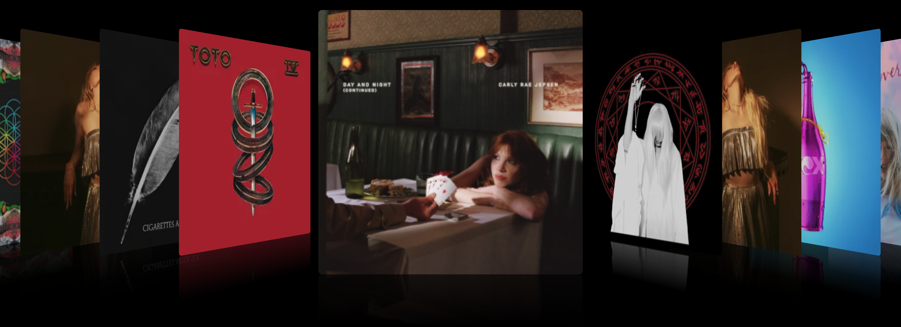

# Honeycrisp

**A native Apple Music client for macOS, built to be fast.** Pure AppKit and Swift on Apple's
official MusicKit and Apple Music API. No Electron, no web views.

> **Version 0.9** is an early preview. It works day to day, but expect rough edges.

## Download

**[Download Honeycrisp 0.9](https://github.com/sharduldhande/Honeycrisp/releases/latest)**: open
the DMG and drag Honeycrisp to Applications.

You need:

- a Mac with Apple silicon (M1 or later)
- macOS 27
- an Apple Music subscription (without one you can browse, but songs won't play)

On first launch, click **Allow** when macOS asks for access to Apple Music.

## At a glance

| | Honeycrisp | Apple's Music app | |
|---|---|---|---|
| Launch to window | **692 ms** | 1,316 ms | 1.9× faster |
| Open a playlist | **98 ms** | 413 ms | 4.2× faster |
| Open an album from Home | **167 ms** | 395 ms | 2.4× faster |
| Frames missed scrolling the album grid | **10 %** | 38 % | 3.7× fewer |
| RAM | **342 MB** | 462 MB | 1.4× less |
| CPU time over a 4½-minute session | **18.3 s** | 27.2 s | 1.5× less |
| App size | **22 MB** | 65 MB | 2.9× smaller |

## Cover Flow is back!

Open the full player and flip through what's playing as a wall of album covers, the way iTunes
used to. Flick, drag, use the arrow keys or click a cover: whichever one you land on plays. Pinch
to make the covers smaller and see more at once. Every cover is sharp, with its reflection, and
the flow covers the whole list you're playing, shuffled lists included.

## Screenshots

## Privacy

Honeycrisp sends anonymous usage and bug counts so we know it works. They carry a random ID for this
install, not linked to you or your Apple Account, and no IP address or location. You can turn this
off in Settings. Otherwise it talks only to Apple, and to Last.fm if you
connect it.

---

Honeycrisp is an independent project and is not affiliated with or endorsed by Apple. Apple Music
is a trademark of Apple Inc.
